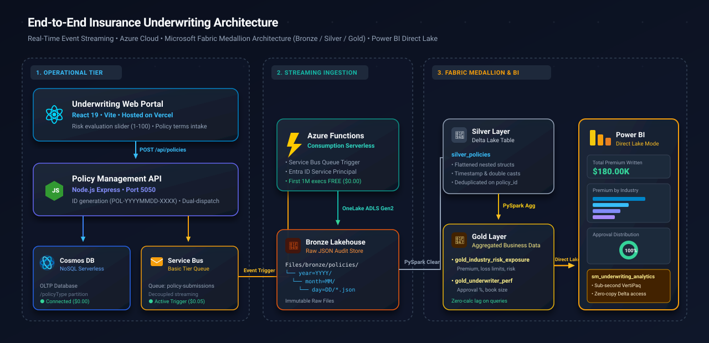
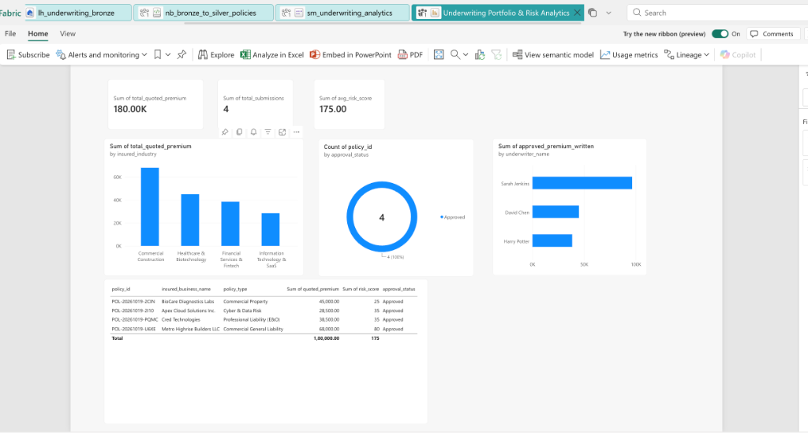

# Real-Time Underwriting Cloud Data Platform & Medallion Architecture

<p align="center">
  <a href="https://underwriting-cloud-data-platform.vercel.app"></a>
  
  
  
</p>

<p align="center">
  
  
  
  
  
</p>

<p align="center">
  
  
  
  
  
  
  
</p>

> 🌐 **Interactive Live Web Demo**: [https://underwriting-cloud-data-platform.vercel.app](https://underwriting-cloud-data-platform.vercel.app)

An end-to-end, event-driven insurance underwriting data engineering platform. Built with **React**, **Node.js (Express)**, **Azure Cosmos DB**, **Azure Service Bus**, **Azure Functions**, **Microsoft Fabric OneLake**, **PySpark / Delta Lake**, and **Power BI (Direct Lake)**.

---

## 🏗️ Architecture & Data Pipeline Flow



### 🛣️ End-to-End Data Journey

| Stage | Layer | Technology | Data Format | Latency / Mode |
| :---: | :--- | :--- | :--- | :--- |
| **01** | **Intake & Evaluation** | React 19 + Vite | Form State | Client-Side Dynamic |
| **02** | **API & Event Producer** | Node.js + Express | JSON Document | `< 50ms` REST API |
| **03** | **OLTP Storage** | Azure Cosmos DB (NoSQL) | JSON Documents | Serverless Single-Digit ms |
| **04** | **Message Broker** | Azure Service Bus | AMQP Events | FIFO Queue Streaming |
| **05** | **Streaming Consumer** | Azure Function App | OneLake ADLS Gen2 REST | Event-Driven Serverless |
| **06** | 🥉 **Bronze Lakehouse** | Microsoft Fabric OneLake | Hierarchical JSON (`YYYY/MM/DD`) | Raw Immutable Audit Store |
| **07** | 🥈 **Silver Layer** | Apache Spark / Delta Lake | Parquet Delta (`silver_policies`) | Cleaned, Typed, Deduplicated |
| **08** | 🥇 **Gold Layer** | Apache Spark / Delta Lake | Aggregated Delta Parquet | Dimensional Business Metrics |
| **09** | 📊 **Executive BI** | Power BI Direct Lake | VertiPaq In-Memory | Zero-Copy Sub-second Queries |

---

## 📊 Executive Dashboard Preview (Power BI Direct Lake)



---

## 🌟 Key Features

1. **Underwriter Portal (React + Vite)**:
   - Dynamic insurance risk score evaluator (1 - 100) with automatic risk tier classification (Low, Standard, High Hazard).
   - Real-time pipeline status indicator for connected Azure cloud services.
   - Live JSON payload inspector displaying the exact landing schema for Bronze OneLake.

2. **Enterprise Operational Backend (Express + Cosmos DB)**:
   - Validates incoming policy submissions and provisions unique policy tracking IDs (`POL-YYYYMMDD-XXXX`).
   - Persists documents into **Azure Cosmos DB** (partitioned by `/policyType`).
   - Dispatches messages to **Azure Service Bus** (`policy-submissions` queue) with zero compute contention.

3. **Event-Driven OneLake Ingestion (Azure Function)**:
   - Triggered asynchronously by Service Bus messages.
   - Authenticates via Microsoft Entra ID (Azure AD) Service Principal to Microsoft Fabric OneLake ADLS Gen2 endpoint.
   - Organizes data into date-partitioned folder hierarchies:  
     `Files/bronze/policies/year=YYYY/month=MM/day=DD/{policyId}.json`.

4. **Fabric Medallion Lakehouse Architecture**:
   - **Bronze**: Immutable raw JSON files preserving full fidelity of the original submission.
   - **Silver (`silver_policies`)**: PySpark flattening of nested structures (`insured.*`, `coverage.*`, `riskAssessment.*`), strict typing, and deduplication.
   - **Gold Tables**:
     - `gold_industry_risk_exposure`: Aggregate premiums, coverage limits, and hazard frequencies per industry.
     - `gold_underwriter_performance`: Book-of-business value, review volumes, and approval percentages per underwriter.

5. **Power BI Direct Lake Dashboard**:
   - Connects directly to Delta Parquet tables in OneLake via **Direct Lake** mode (no data refresh lag, sub-second query performance).

---

## 📁 Repository Structure

```
.
├── backend/                  # Node.js Express API & Azure Cloud Connectors
│   ├── src/
│   │   ├── config.js         # Configuration loader
│   │   ├── routes/           # Express policy endpoints
│   │   ├── services/         # Cosmos DB & Service Bus drivers
│   │   └── server.js         # Server entry point
│   ├── .env.example          # Environment variables template
│   └── package.json
│
├── frontend/                 # Underwriter React Application (Vite)
│   ├── src/
│   │   ├── App.jsx           # Main underwriting intake dashboard
│   │   ├── index.css         # Modern styling & pipeline banner
│   │   └── main.jsx
│   ├── vite.config.js        # Proxy configuration to API
│   └── package.json
│
├── azure-function/           # Event-driven Ingestion to Fabric Bronze
│   ├── src/
│   │   ├── fabricWriter.js   # OneLake ADLS Gen2 writer module
│   │   ├── localWorker.js    # Continuous local worker for testing
│   │   └── functions/        # Azure Function Service Bus trigger definition
│   ├── .env.example
│   └── package.json
│
├── fabric-notebooks/         # PySpark Medallion Notebooks
│   ├── 01_bronze_to_silver.py # Flattens Bronze JSONs into Silver Delta table
│   └── 02_silver_to_gold.py   # Aggregates business metrics for Gold tables
│
├── .gitignore
├── package.json              # Monorepo root scripts
└── README.md
```

---

## 🚀 Getting Started

### 1. Prerequisites

- Node.js (v18+ or v20+)
- Azure Subscription (Cosmos DB NoSQL & Service Bus Basic Tier)
- Microsoft Fabric Tenant (Workspace & Lakehouse with 60-day trial)

### 2. Environment Configuration

Copy `.env.example` in both `backend` and `azure-function`:

```bash
# In backend/.env:
PORT=5050
COSMOS_DB_ENDPOINT=https://<your-cosmos-account>.documents.azure.com:443/
COSMOS_DB_KEY=<your-primary-key>
COSMOS_DB_DATABASE_ID=underwriting-db
COSMOS_DB_CONTAINER_ID=policies
SERVICE_BUS_CONNECTION_STRING=Endpoint=sb://<your-namespace>.servicebus.windows.net/...
SERVICE_BUS_QUEUE_NAME=policy-submissions

# In azure-function/.env:
SERVICE_BUS_CONNECTION_STRING=Endpoint=sb://<your-namespace>.servicebus.windows.net/...
SERVICE_BUS_QUEUE_NAME=policy-submissions
AZURE_TENANT_ID=<your-tenant-id>
AZURE_CLIENT_ID=<your-app-client-id>
AZURE_CLIENT_SECRET=<your-client-secret>
FABRIC_WORKSPACE_NAME=<your-fabric-workspace>
FABRIC_LAKEHOUSE_NAME=lh_underwriting_bronze
```

### 3. Running Locally

**Install dependencies:**

```bash
cd backend && npm install
cd ../frontend && npm install
cd ../azure-function && npm install
cd ..
```

**Run Backend API (Port 5050):**

```bash
npm run dev:backend
```

**Run React Underwriter Portal (Port 3000):**

```bash
npm run dev:frontend
```

**Run Fabric Bronze Ingestion Worker:**

```bash
npm run worker:fabric
```

---

## 📊 Medallion PySpark Transformations

### Bronze &rarr; Silver:

```python
# Flattens nested JSON & writes to Delta Lake
silver_df_clean.write \
    .format("delta") \
    .mode("overwrite") \
    .saveAsTable("silver_policies")
```

### Silver &rarr; Gold:

```python
# Aggregates by industry exposure and saves curated business table
gold_industry_risk_exposure.write \
    .format("delta") \
    .mode("overwrite") \
    .saveAsTable("gold_industry_risk_exposure")
```

---

## 🛡️ Cost & Budget Optimization

This architecture was specifically designed for **near-zero cost development**:

- **Azure Cosmos DB**: Serverless mode (\$0 when idle, fractions of cents per operation).
- **Azure Service Bus**: Basic tier (\$0.05 per million operations, \$0 base fee).
- **Azure Functions**: Consumption plan (First 1,000,000 executions/month free).
- **Microsoft Fabric**: Fabric 60-day Capacity Trial (\$0).
- Total development cost: **< \$1.00 / month**.
