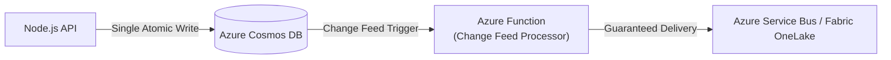

# 🚀 Enterprise Evolution & Production Improvements
## Scaling from MVP to High-Throughput Enterprise Architecture

This document details the architectural evolutions, production hardening steps, and alternative engineering choices to transition this platform into a Tier-1, high-throughput enterprise system.

---

## 1. Eliminate the "Dual-Write" Problem via Cosmos DB Change Feed

### The Issue with the Current Pattern:
In the current implementation, the Node.js API writes sequentially to Cosmos DB, then publishes to Azure Service Bus:
```
Client POST ➔ [Cosmos DB Write] ➔ [Service Bus Publish] ➔ HTTP 201
```
If the database write succeeds but the network blips before Service Bus receives the message, the operational database and the downstream analytics lakehouse become **permanently inconsistent**.

### The Enterprise Solution: Cosmos DB Change Feed Trigger
Instead of the application writing to two destinations, the API writes **only to Cosmos DB**. An Azure Function triggers natively on the **Cosmos DB Change Feed** (its internal ACID transaction log):



**Benefits**:
* Guarantees at-least-once delivery with zero dual-write risk.
* Database write latency drops because the API no longer waits for a messaging round-trip.
* Automatic checkpointing and partition-aware parallel processing.

---

## 2. Zero-Trust Security: Managed Identity & Azure Key Vault

### The Issue with the Current Pattern:
Connection strings and Client Secrets are stored in `.env` files. In enterprise teams, secrets can expire, leak, or fail compliance audits.

### The Enterprise Solution: Passwordless RBAC
Migrate to **Azure Managed Identity** and **Azure Key Vault**:

1. Enable **System-Assigned Managed Identity** on the Azure Function App.
2. Grant specific Role-Based Access Control (RBAC) roles:
   * **Azure Service Bus Data Receiver** on the Service Bus namespace.
   * **Storage Blob Data Contributor** on the Fabric OneLake workspace.
3. Replace connection strings with `DefaultAzureCredential`:

```javascript
import { DefaultAzureCredential } from '@azure/identity';
import { DataLakeServiceClient } from '@azure/storage-file-datalake';

// Zero hardcoded secrets, keys, or passwords
const credential = new DefaultAzureCredential();
const serviceClient = new DataLakeServiceClient('https://onelake.dfs.fabric.microsoft.com', credential);
```

---

## 3. Native Fabric Ingestion: Fabric Eventstream

### The Current Pattern:
A custom Node.js Azure Function using `@azure/storage-file-datalake` writes JSON files to OneLake.

### The Enterprise Alternative:
Microsoft Fabric now features **Fabric Eventstream**:
* Directly hooks into **Azure Service Bus** or **Azure Event Hubs** as a native source.
* Ingests, date-partitions, and buffers data directly into Lakehouse Delta tables without requiring custom Azure Function code.
* Reduces infrastructure maintenance, runtime patching, and custom code deployments.

---

## 4. Near-Real-Time Analytics: Spark Structured Streaming

### The Current Pattern:
PySpark notebooks run in batch mode (manually or on a schedule), creating a latency window between file landing and table updates.

### The Enterprise Solution:
Convert the PySpark job into a continuous **Spark Structured Streaming** application with Delta Lake:

```python
# Streaming Bronze to Silver pipeline
streaming_bronze_df = spark.readStream \
    .format("cloudFiles") \
    .option("cloudFiles.format", "json") \
    .option("cloudFiles.schemaLocation", "Files/checkpoints/schema") \
    .load("Files/bronze/policies/*/*/*/*.json")

query = streaming_bronze_df.writeStream \
    .format("delta") \
    .outputMode("append") \
    .option("checkpointLocation", "Files/checkpoints/silver_policies") \
    .toTable("silver_policies")
```

**Benefits**:
* Reduces end-to-end latency from hours/minutes down to **under 10 seconds**.
* Uses **Delta Lake Auto-Loader** to automatically detect and ingest new files without costly directory scans.

---

## 5. Automated Data Quality & Quarantine Tables

### The Issue with the Current Pattern:
The transformation assumes all submitted JSON documents conform to business rules. Corrupted inputs could break downstream models or pollute the Silver table.

### The Enterprise Solution: The Dead-Letter / Quarantine Pattern
Implement validation rules before appending to `silver_policies`:

```python
from pyspark.sql.functions import col, when

# Validation rules: premium > 0, coverage_limit > deductible, valid policy_id
valid_df = silver_df.filter(
    (col("quoted_premium") > 0) & 
    (col("coverage_limit") > col("deductible_amount")) &
    (col("policy_id").isNotNull())
)

quarantine_df = silver_df.filter(
    (col("quoted_premium") <= 0) | 
    (col("coverage_limit") <= col("deductible_amount")) |
    (col("policy_id").isNull())
)

# Route valid rows to Silver, bad rows to Quarantine
valid_df.write.format("delta").mode("append").saveAsTable("silver_policies")
quarantine_df.write.format("delta").mode("append").saveAsTable("silver_quarantine_policies")
```

---

## 6. Resolving the "Small Files Problem" via Delta Compaction

### The Problem:
Writing 1 JSON file per policy at 100,000 policies/day generates 100,000 tiny files, creating heavy metadata overhead and slow Spark scans.

### The Enterprise Solution:
1. **Ingestion Buffering**: Configure Azure Functions or Eventstream to buffer writes in 1-minute or 1,000-record batches.
2. **Delta Lake Compaction & Z-Ordering**: Schedule regular maintenance on the Silver and Gold tables:

```sql
-- Merges small Parquet files into optimal ~128MB to 1GB files
OPTIMIZE silver_policies
ZORDER BY (submission_year, submission_month, policy_type);
```

---

## 7. Infrastructure as Code (IaC) & CI/CD

### Current Setup:
Azure resources were created via the Azure Portal ("ClickOps").

### Enterprise Production Setup:
* Define all resources in **Terraform** or **Azure Bicep** templates:
  - Resource Groups, Cosmos DB NoSQL accounts, Service Bus namespaces/queues, and Function Apps.
* Manage deployments via **GitHub Actions CI/CD workflows**:
  - `dev` branch deploys to `rg-underwriter-dev`.
  - `main` branch deploys to `rg-underwriter-prod` after automated unit and integration tests pass.
